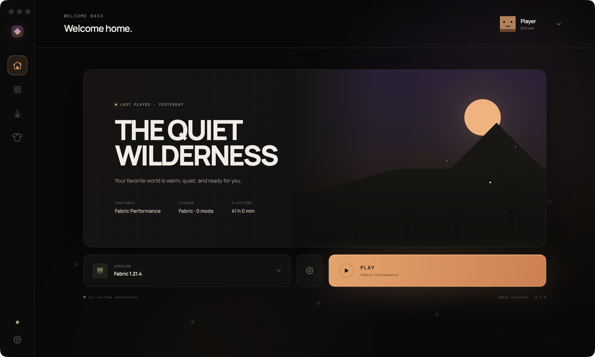
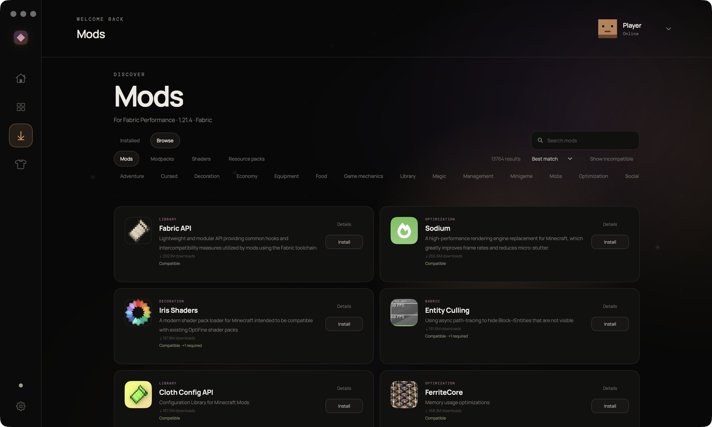
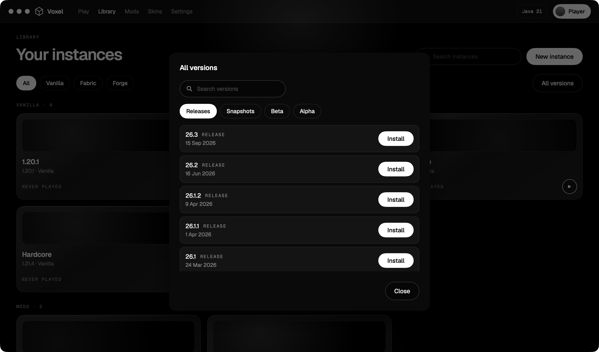
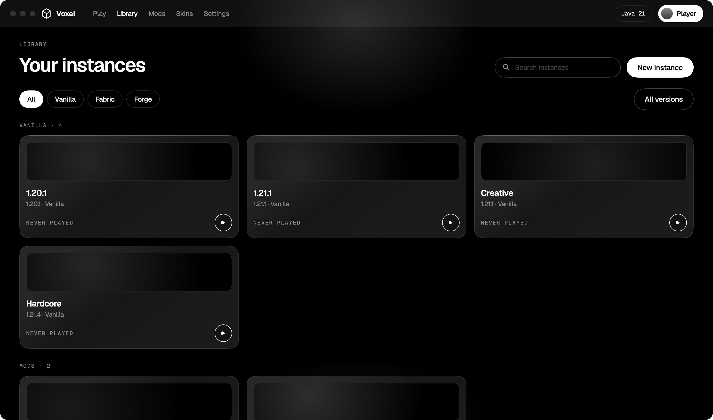

<div align="center">

# Voxel

**Швидкий нативний лаунчер Minecraft для Mac на Apple Silicon, з ШІ-генератором модпаків.**

[English](README.md) · Українська

[](https://github.com/SnowyMay111/mc-launcher/releases/latest)


[](LICENSE)



</div>

## Що вміє

- **Будь-яка версія Minecraft в один клік.** Релізи, снепшоти та навіть старі бета- й альфа-збірки, прямо з серверів Mojang. Оберіть версію, натисніть **Install**, грайте.
- **Каталог модів, модпаків, шейдерів і ресурспаків** з [Modrinth](https://modrinth.com). Кожен пункт показує, чи підходить він до вашої версії гри та завантажувача, а потім встановлюється разом із залежностями однією кнопкою. Шейдери самі підтягують Iris і Sodium.
- **ШІ-генератор модпаків.** Опишіть збірку простими словами («легка, швидка, технічна в стилі Create, без хорору»). ШІ підбирає моди, пояснює чому, ви знімаєте відмітки з небажаних, і після перевірки сумісності збірка встановлюється. Використовуйте власний ключ Claude або Gemini, він зберігається у Keychain macOS.
- **Створено для Mac.** Нативна ARM-Java з офіційного маніфесту середовища Mojang, профілі JVM (G1 / ZGC), пресети пам'яті під ваш Mac, профіль продуктивності в один клік з Sodium і Lithium.
- **Безпечні зміни.** Резервні копії світів перед кожною зміною версії, відкат однією кнопкою, перевірка, чи зможуть ваші моди перейти на нову версію.
- **Дізнайтеся, чому гра вилетіла.** Журнал гри в реальному часі, аналізатор вильотів, який називає винний мод або налаштування, звіт про стан сесії.
- **Діліться збірками.** Імпорт і експорт файлів `.mrpack`.
- **Оновлюється сам.** Лаунчер перевіряє GitHub Releases під час запуску; коли вийде нова версія, з'являється кнопка, один клік завантажує і встановлює її.
- Офлайн-нік за замовчуванням, інтерфейс англійською, російською та українською мовами.

<div align="center">


</div>

<div align="center">

</div>

## Встановлення

Потрібен Mac з чипом Apple (M1 або новіший) і macOS 14 або новіша. Встановлювати Minecraft або Java **не потрібно**: Voxel завантажує все, що потрібно грі.

1. Завантажте **`Voxel-mac-arm64.zip`** з [останнього релізу](https://github.com/SnowyMay111/mc-launcher/releases/latest) і розпакуйте його.
2. Перетягніть **`Voxel.app`** у папку **Applications** (Програми).
3. Лише при першому запуску: застосунок ще не нотаризований Apple, тому macOS відмовиться його відкрити. Відкрийте **Terminal** (Термінал), вставте це і натисніть Enter:

   ```bash
   xattr -dr com.apple.quarantine /Applications/Voxel.app
   ```

   (Або: *Системні налаштування → Конфіденційність і безпека → Усе одно відкрити*.) Після цього застосунок відкривається, як будь-який інший.
4. Натисніть **New instance**, оберіть версію Minecraft, натисніть **Create**, потім **Play**. Нік задайте в **Settings**.

Старі версії (до 1.18) працюють через Rosetta. Якщо Voxel це запропонує, виконайте один раз:

```bash
softwareupdate --install-rosetta --agree-to-license
```

Далі Voxel оновлюється сам.

## Збірка із вихідного коду

Xcode не потрібен, достатньо Command Line Tools і Swift 6.

```bash
git clone https://github.com/SnowyMay111/mc-launcher.git
cd mc-launcher
scripts/build-app.sh          # збирає build/Voxel.app
scripts/package-app.sh        # збірка для релізу + dist/Voxel-mac-arm64.zip
```

Логіка гри міститься в пакеті `LauncherCore` (лише Foundation, без AppKit і SwiftUI), тож її можна буде повторно використати для версії під Windows. `launcher-cli` запускає те саме ядро з терміналу.

## Дорожня карта

Forge і NeoForge, CurseForge як другий каталог, вхід через Microsoft, нотаризація Apple, Windows.

## Застереження

Voxel є неофіційним лаунчером. Він не схвалений Mojang або Microsoft і не пов'язаний з ними. Файли гри Minecraft ніколи не поставляються разом із застосунком: вони завантажуються з офіційних серверів Mojang. Режим офлайн-ніка призначений для гри наодинці, у локальній мережі та на офлайн-серверах; для гри на офіційних серверах, будь ласка, придбайте гру.

## Подяки та ліцензія

Моди і збірки беруться з API [Modrinth](https://modrinth.com). Шрифт інтерфейсу: [Geist](https://vercel.com/font) (SIL Open Font License). Voxel поширюється за [ліцензією MIT](LICENSE).
