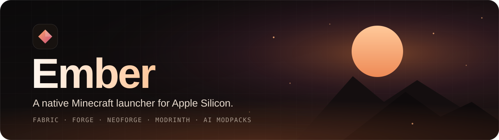
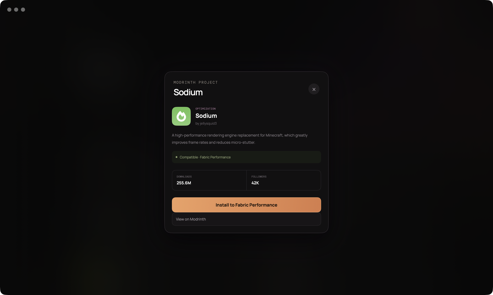
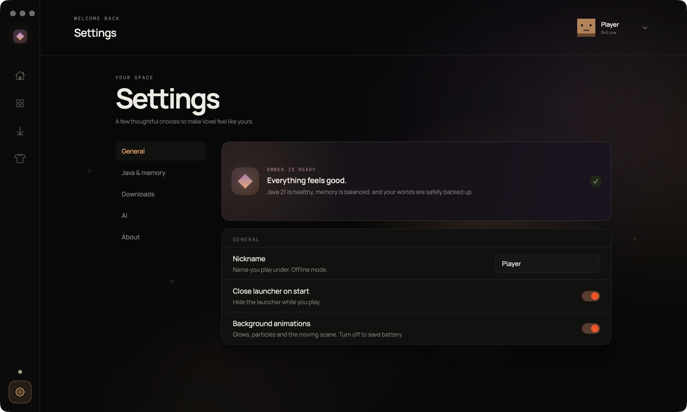
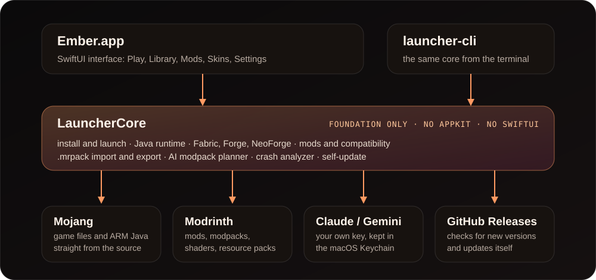

<div align="center">



<br>

**Оберіть версію й натисніть «Грати». Або опишіть потрібну збірку словами, і ШІ складе її за вас.**

[English](README.md) · [Русский](README.ru.md) · Українська

[](https://github.com/SnowyMay111/ember-launcher/releases/latest)


[](LICENSE)

[Завантажити](https://github.com/SnowyMay111/ember-launcher/releases/latest) · [Що нового](#whats-new) · [Можливості](#features) · [Скріншоти](#screenshots) · [Як це влаштовано](#how-it-works) · [Встановлення](#install) · [Запитання й відповіді](#faq) · [Плани](#roadmap)


</div>

<table>
  <tr>
    <td width="33%" valign="top"><b>Зроблений для Mac</b><br>Нативна ARM-Java просто з маніфесту рантаймів Mojang, профілі JVM, пресети пам'яті під ваш Mac, профіль продуктивності з Sodium і Lithium одним кліком. Системна Java не потрібна.</td>
    <td width="33%" valign="top"><b>Моди без здогадок</b><br>Каталог Modrinth, де кожна картка каже, чи підходить вона вашій версії гри та завантажувачу, і встановлюється разом із залежностями. Або попросіть ШІ спланувати цілу збірку з одного речення.</td>
    <td width="33%" valign="top"><b>Зміни можна скасувати</b><br>Бекап світів перед кожною зміною версії, відкат однією кнопкою, аналізатор вильотів, який називає винний мод, і живий лог гри.</td>
  </tr>
</table>

<a id="whats-new"></a>
## Що нового

**0.2.1: Voxel тепер Ember.** Лаунчер має нову назву. Застосунок називається `Ember.app`, завантажувати потрібно `Ember-mac-arm64.zip`, а ваші збірки, світи, налаштування й ключ у Keychain лишаються на своїх місцях. Якщо у вас уже стоїть 0.1.0 або 0.2.0, вбудоване оновлення саме переведе вас на Ember; під час першого оновлення файл залишиться з іменем `Voxel.app`, за бажання перейменуйте його у Finder.

**0.2.0: новий вигляд і багато нового всередині.**

- Теплий темний інтерфейс **Ember** з головним екраном запуску та живим тлом, яке можна вимкнути.
- **Forge і NeoForge** ставляться разом із Minecraft, каталог працює в будь-якій збірці, а імпорт та експорт `.mrpack` підтримує обидві платформи.
- Екран **Скіни**, панель з деталями збірки, групи збірок і сторінка мода зі встановленням однією кнопкою.
- Безпечне видалення збірок і завантажених версій гри, розумніший добір версій модів і налаштування на одній сторінці з прокруткою.

Уся історія змін у [журналі змін](CHANGELOG.md).

<a id="features"></a>
## Можливості

- **Будь-яка версія Minecraft одним кліком.** Релізи, снапшоти і навіть старі бети та альфи просто з серверів Mojang. Оберіть версію, натисніть **Встановити**, грайте.
- **Vanilla, Fabric, Forge і NeoForge.** Завантажувач ставиться разом із грою, а в будь-якій збірці доступний каталог модів і шейдерів.
- **Каталог модів, збірок, шейдерів і ресурспаків** із [Modrinth](https://modrinth.com). Кожна картка показує, чи підходить вона вашій версії гри та завантажувачу, і встановлюється разом із залежностями однією кнопкою. Версії модів підбираються під те, що вже встановлено; результати, які не підходять, сховані за перемикачем *Показати несумісні*. Шейдери самі підтягують Iris і Sodium.
- **ШІ-генератор збірок.** Опишіть збірку звичайними словами («легка, швидка, техно в стилі Create, без хорорів»): ШІ підбере моди й пояснить вибір, ви приберете позначки з зайвого, і після перевірки сумісності все встановиться. Використайте власний ключ Claude або Gemini, він зберігається в в'язці ключів macOS (Keychain).
- **Зроблений для Mac.** Нативна ARM-Java, профілі JVM (G1 / ZGC), пресети пам'яті під ваш Mac, профіль продуктивності одним кліком із Sodium і Lithium.
- **Безпечні зміни.** Бекап світів перед кожною зміною версії, відкат однією кнопкою, перевірка, чи зможуть ваші моди перейти на нову версію.
- **Зрозуміло, чому гра вилетіла.** Живий лог гри, аналізатор вильотів, який називає винний мод чи налаштування, звіт про стан сесії.
- **Діліться збірками.** Імпорт та експорт файлів `.mrpack`, зокрема збірок Forge і NeoForge.
- **Охайна бібліотека.** Групи для збірок, панель з деталями (огляд, моди, світи, логи), безпечне видалення збірок і завантажених версій гри: версію, яку ще використовує збірка, видалити не можна.
- **Скіни.** Імпорт скінів PNG 64×64, перегляд спереду й ззаду, власна колекція на вашому Mac. Обраний скін гра застосує після входу через Microsoft, якого поки немає.
- **Гарно й спокійно.** Теплий темний інтерфейс Ember з живим тлом (один перемикач вимикає анімації та заощаджує батарею), англійська, російська й українська мови.
- **Оновлюється сам.** Лаунчер перевіряє GitHub Releases під час запуску; коли виходить нова версія, з'являється кнопка, один клік завантажує й встановлює її.
- За замовчуванням нік працює офлайн.

<a id="screenshots"></a>
## Скріншоти

<table>
  <tr>
    <td align="center"><br><sub><b>Бібліотека</b>: усі світи в одному місці</sub></td>
    <td align="center"><br><sub><b>Каталог</b>: сумісність на кожній картці</sub></td>
  </tr>
  <tr>
    <td align="center"><br><sub><b>Сторінка мода</b>: одна кнопка, залежності включено</sub></td>
    <td align="center"><br><sub><b>Усі версії</b>: релізи, снапшоти, бети, альфи</sub></td>
  </tr>
  <tr>
    <td align="center" colspan="2"><br><sub><b>Налаштування</b>: одна сторінка, бічне меню йде за вами</sub></td>
  </tr>
</table>

<a id="how-it-works"></a>
## Як це влаштовано



Уся логіка гри лежить у `LauncherCore`: це пакет на Swift, який використовує лише Foundation (без AppKit і SwiftUI). Застосунок лише один з інтерфейсів поверх нього, `launcher-cli` інший, тож ядро можна буде використати для версії під Windows. Файли гри та Java приходять від Mojang, моди з Modrinth, а ваш ключ ШІ іде лише обраному провайдеру.

<a id="install"></a>
## Встановлення

Потрібен Mac із чипом Apple (M1 або новіший) і macOS 14 або новіша. Встановлювати Minecraft чи Java **не потрібно**: Ember сам завантажить усе, що потрібно грі.

1. Завантажте **`Ember-mac-arm64.zip`** з [останнього релізу](https://github.com/SnowyMay111/ember-launcher/releases/latest) і розпакуйте.
2. Перетягніть **`Ember.app`** у теку **Програми**.
3. Лише під час першого запуску: застосунок ще не нотаризований Apple, тому macOS відмовиться його відкрити. Відкрийте **Термінал**, вставте команду й натисніть Enter:

   ```bash
   xattr -dr com.apple.quarantine /Applications/Ember.app
   ```

   (Або: *Системні налаштування → Конфіденційність і безпека → Усе одно відкрити*.) Після цього застосунок відкривається як звичайно.
4. Натисніть **Нова збірка**, оберіть версію Minecraft, натисніть **Створити**, потім **Грати**. Нік задається в **Налаштуваннях**.

Старі версії (до 1.18) працюють через Rosetta. Якщо Ember попросить, виконайте один раз:

```bash
softwareupdate --install-rosetta --agree-to-license
```

Далі Ember оновлюється сам.

<a id="faq"></a>
## Запитання й відповіді

<details>
<summary><b>Ember безкоштовний?</b></summary>

Так. Вихідний код відкритий, ліцензія [MIT](LICENSE). Сам Minecraft до комплекту не входить, файли Mojang лаунчер із собою не носить.
</details>

<details>
<summary><b>Чи потрібно купувати Minecraft?</b></summary>

Офлайн-режим із ніком призначений для одиночної гри, локальної мережі та офлайн-серверів. Щоб грати на офіційних серверах, придбайте гру. Вхід через Microsoft є в планах.
</details>

<details>
<summary><b>macOS пише, що застосунок не можна відкрити. Це безпечно?</b></summary>

Збірку підписано локально, але ще не нотаризовано Apple (для цього потрібен платний обліковий запис розробника), тому Gatekeeper блокує перший запуск. Команда `xattr` з розділу [Встановлення](#install) знімає мітку карантину; вихідний код лежить у цьому репозиторії, його можна перевірити або зібрати самому.
</details>

<details>
<summary><b>Чи працює на Mac з процесором Intel?</b></summary>

Ні, збірка лише для Apple Silicon (M1 і новіші).
</details>

<details>
<summary><b>Де Ember зберігає свої файли?</b></summary>

У `~/Library/Application Support/mc-launcher`: збірки, світи, бекапи, завантажені версії та Java. Назва теки під час перейменування не змінювалася, тож нічого переносити не потрібно. Ключ ШІ лежить у в'язці ключів macOS, а не у файлі.
</details>

<details>
<summary><b>Чи безпечний мій ключ ШІ?</b></summary>

Він зберігається в в'язці ключів macOS, у логи не потрапляє й іде лише обраному провайдеру (Claude або Gemini). Ви платите провайдеру напряму; в Ember немає власних серверів.
</details>

<details>
<summary><b>У мене вже є збірка. Чи можна її використати?</b></summary>

Так. Імпортуйте будь-який файл Modrinth `.mrpack` у вікні **Нова збірка**, зокрема збірки Forge і NeoForge. Свої збірки можна експортувати так само.
</details>

<details>
<summary><b>Чому раніше він називався Voxel?</b></summary>

Релізи до 0.2.0 вийшли під назвою Voxel. З 0.2.1 проєкт називається Ember. Вбудоване оновлення саме переведе вас на нову назву, а старі назви завантажень і далі працюють для вже встановлених копій.
</details>

<details>
<summary><b>Чи будуть версії для Windows і Linux?</b></summary>

Windows є в планах. Ядро переносне, а інтерфейс на SwiftUI ні, тому для Windows знадобиться власний інтерфейс поверх `LauncherCore`.
</details>

<a id="build-from-source"></a>
## Збірка з вихідного коду

Xcode не потрібен, достатньо Command Line Tools і тулчейна Swift 6.

```bash
git clone https://github.com/SnowyMay111/ember-launcher.git
cd ember-launcher
scripts/build-app.sh          # builds build/Ember.app
scripts/package-app.sh        # release build + dist/Ember-mac-arm64.zip
```

Хочете надіслати правку? Читайте [CONTRIBUTING.md](CONTRIBUTING.md).

<a id="roadmap"></a>
## Плани

- [x] Vanilla і Fabric, каталог модів, ШІ-генератор
- [x] Forge і NeoForge
- [x] Імпорт та експорт `.mrpack`
- [x] Самооновлення з GitHub Releases
- [x] Інтерфейс і назва Ember
- [ ] Вхід через Microsoft
- [ ] CurseForge як другий каталог
- [ ] Нотаризація Apple
- [ ] Windows

Знайшли помилку чи маєте ідею? [Створіть issue](https://github.com/SnowyMay111/ember-launcher/issues/new/choose).

## Відмова від відповідальності

Ember — неофіційний лаунчер. Його не схвалено Mojang чи Microsoft, і він не пов'язаний із ними. Файли гри Minecraft до лаунчера не входять: вони завантажуються з офіційних серверів Mojang. Офлайн-режим із ніком призначений для одиночної гри, локальної мережі та офлайн-серверів; щоб грати на офіційних серверах, придбайте гру.

## Подяки та ліцензія

Моди та збірки надходять з API [Modrinth](https://modrinth.com). Шрифти інтерфейсу: [Geist](https://vercel.com/font), [Manrope](https://fonts.google.com/specimen/Manrope) і [DM Mono](https://fonts.google.com/specimen/DM+Mono) (усі під SIL Open Font License). Ember поширюється за ліцензією [MIT](LICENSE).
