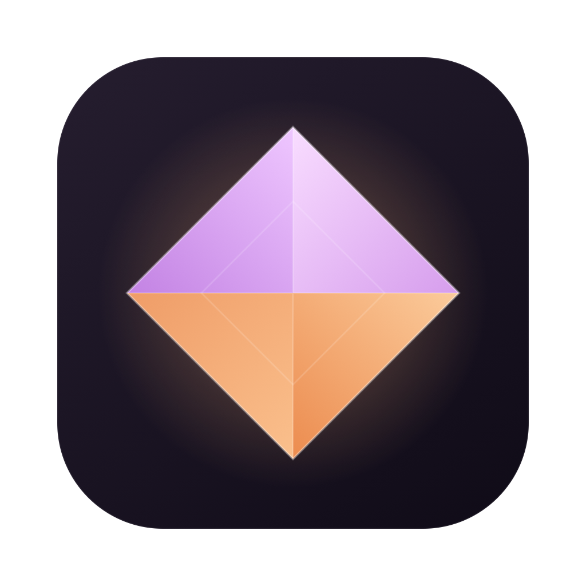

<div align="center">



# Voxel

**Швидкий нативний лаунчер Minecraft для Mac на Apple Silicon, зі ШІ-генератором збірок.**

[English](README.md) · [Русский](README.ru.md) · Українська

[](https://github.com/SnowyMay111/mc-launcher/releases/latest)


[](LICENSE)

[Завантажити](https://github.com/SnowyMay111/mc-launcher/releases/latest) · [Можливості](#features) · [Скріншоти](#screenshots) · [Встановлення](#install) · [Збірка з вихідного коду](#build-from-source) · [Плани](#roadmap)


</div>

<a id="features"></a>
## Можливості

- **Будь-яка версія Minecraft одним кліком.** Релізи, снапшоти і навіть старі бети та альфи просто з серверів Mojang. Оберіть версію, натисніть **Встановити**, грайте.
- **Vanilla, Fabric, Forge і NeoForge.** Завантажувач ставиться разом із грою, а в будь-якій збірці доступний каталог модів і шейдерів.
- **Каталог модів, збірок, шейдерів і ресурспаків** із [Modrinth](https://modrinth.com). Кожна картка показує, чи підходить вона вашій версії гри та завантажувачу, і встановлюється разом із залежностями однією кнопкою. Версії модів підбираються під те, що вже встановлено; результати, які не підходять, сховані за перемикачем *Показати несумісні*. Шейдери самі підтягують Iris і Sodium.
- **ШІ-генератор збірок.** Опишіть збірку звичайними словами («легка, швидка, техно в стилі Create, без хорорів»): ШІ підбере моди й пояснить вибір, ви приберете позначки з зайвого, і після перевірки сумісності все встановиться. Використайте власний ключ Claude або Gemini, він зберігається в в'язці ключів macOS (Keychain).
- **Зроблений для Mac.** Нативна ARM-Java з маніфесту рантаймів Mojang, профілі JVM (G1 / ZGC), пресети пам'яті під ваш Mac, профіль продуктивності одним кліком із Sodium і Lithium.
- **Безпечні зміни.** Бекап світів перед кожною зміною версії, відкат однією кнопкою, перевірка, чи зможуть ваші моди перейти на нову версію.
- **Зрозуміло, чому гра вилетіла.** Живий лог гри, аналізатор вильотів, який називає винний мод чи налаштування, звіт про стан сесії.
- **Діліться збірками.** Імпорт та експорт файлів `.mrpack`, зокрема збірок Forge і NeoForge.
- **Охайна бібліотека.** Групи для збірок, панель з деталями (огляд, моди, світи, логи), безпечне видалення збірок і завантажених версій гри: версію, яку ще використовує збірка, видалити не можна.
- **Скіни.** Імпорт скінів PNG 64×64, перегляд спереду й ззаду, власна колекція на вашому Mac. Обраний скін гра застосує після входу через Microsoft, якого поки немає.
- **Гарно й спокійно.** Теплий темний інтерфейс *Ember* з живим тлом (один перемикач вимикає анімації та заощаджує батарею), англійська, російська й українська мови.
- **Оновлюється сам.** Лаунчер перевіряє GitHub Releases під час запуску; коли виходить нова версія, з'являється кнопка, один клік завантажує й встановлює її.
- За замовчуванням нік працює офлайн.

<a id="screenshots"></a>
## Скріншоти

<table>
  <tr>
    <td align="center"><br><sub><b>Бібліотека</b>: усі світи в одному місці</sub></td>
    <td align="center"><br><sub><b>Каталог</b>: сумісність на кожній картці</sub></td>
  </tr>
  <tr>
    <td align="center"><br><sub><b>Сторінка мода</b>: одна кнопка, залежності включено</sub></td>
    <td align="center"><br><sub><b>Усі версії</b>: релізи, снапшоти, бети, альфи</sub></td>
  </tr>
  <tr>
    <td align="center" colspan="2"><br><sub><b>Налаштування</b>: одна сторінка, бічне меню йде за вами</sub></td>
  </tr>
</table>

<a id="install"></a>
## Встановлення

Потрібен Mac із чипом Apple (M1 або новіший) і macOS 14 або новіша. Встановлювати Minecraft чи Java **не потрібно**: Voxel сам завантажить усе, що потрібно грі.

1. Завантажте **`Voxel-mac-arm64.zip`** з [останнього релізу](https://github.com/SnowyMay111/mc-launcher/releases/latest) і розпакуйте.
2. Перетягніть **`Voxel.app`** у теку **Програми**.
3. Лише під час першого запуску: застосунок ще не нотаризований Apple, тому macOS відмовиться його відкрити. Відкрийте **Термінал**, вставте команду й натисніть Enter:

   ```bash
   xattr -dr com.apple.quarantine /Applications/Voxel.app
   ```

   (Або: *Системні налаштування → Конфіденційність і безпека → Усе одно відкрити*.) Після цього застосунок відкривається як звичайно.
4. Натисніть **Нова збірка**, оберіть версію Minecraft, натисніть **Створити**, потім **Грати**. Нік задається в **Налаштуваннях**.

Старі версії (до 1.18) працюють через Rosetta. Якщо Voxel попросить, виконайте один раз:

```bash
softwareupdate --install-rosetta --agree-to-license
```

Далі Voxel оновлюється сам.

<a id="build-from-source"></a>
## Збірка з вихідного коду

Xcode не потрібен, достатньо Command Line Tools і Swift 6.

```bash
git clone https://github.com/SnowyMay111/mc-launcher.git
cd mc-launcher
scripts/build-app.sh          # builds build/Voxel.app
scripts/package-app.sh        # release build + dist/Voxel-mac-arm64.zip
```

Уся логіка гри лежить у пакеті `LauncherCore` (лише Foundation, без AppKit і SwiftUI), щоб згодом її можна було використати для версії під Windows. `launcher-cli` запускає те саме ядро з термінала.

<a id="roadmap"></a>
## Плани

- [x] Vanilla і Fabric, каталог модів, ШІ-генератор
- [x] Forge і NeoForge
- [x] Імпорт та експорт `.mrpack`
- [x] Самооновлення з GitHub Releases
- [ ] Вхід через Microsoft
- [ ] CurseForge як другий каталог
- [ ] Нотаризація Apple
- [ ] Windows

Знайшли помилку чи маєте ідею? [Створіть issue](https://github.com/SnowyMay111/mc-launcher/issues).

## Відмова від відповідальності

Voxel — неофіційний лаунчер. Його не схвалено Mojang чи Microsoft, і він не пов'язаний із ними. Файли гри Minecraft до лаунчера не входять: вони завантажуються з офіційних серверів Mojang. Офлайн-режим із ніком призначений для одиночної гри, локальної мережі та офлайн-серверів; щоб грати на офіційних серверах, придбайте гру.

## Подяки та ліцензія

Моди та збірки надходять з API [Modrinth](https://modrinth.com). Шрифти інтерфейсу: [Geist](https://vercel.com/font), [Manrope](https://fonts.google.com/specimen/Manrope) і [DM Mono](https://fonts.google.com/specimen/DM+Mono) (усі під SIL Open Font License). Voxel поширюється за ліцензією [MIT](LICENSE).
